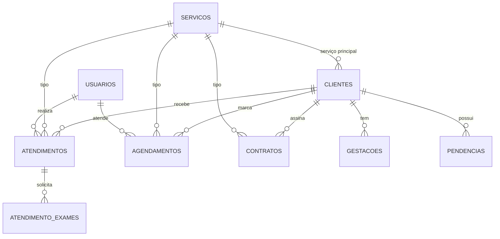

# Banco de dados — Instituto Lírios

Banco relacional em **MySQL 8** (compatível com MariaDB/XAMPP) que substitui o
`localStorage` usado na versão de interface.

```
db/
├── schema.sql      cria o banco, as 9 tabelas, índices e 3 views
├── seed.sql        carrega os dados iniciais (as 7 clientes, contratos, agenda...)
├── consultas.sql   as 14 consultas que as telas usam (documentadas)
└── validar.py      executa o modelo num espelho SQLite e confere tudo
```

## Como criar o banco (MySQL Workbench)

1. Abra o Workbench e conecte no seu servidor local.
2. **File → Open SQL Script…** → `db/schema.sql` → clique no **raio ⚡**.
3. Repita com `db/seed.sql`.
4. Confira em **Schemas → instituto_lirios**.

O script cria o banco (`CREATE DATABASE IF NOT EXISTS instituto_lirios`), então
não precisa criar nada antes.

> Login do usuário criado pelo seed: **katlhen@lirios.com.br** / **senha1234**
> (gravada como hash bcrypt, nunca em texto puro).

## Modelo



| Tabela | Para que serve | Relações |
|---|---|---|
| `usuarios` | login e autoria dos atendimentos | 1:N com atendimentos e agendamentos |
| `servicos` | catálogo (pré-natal, puericultura…) | referenciada por clientes, atendimentos, contratos, agendamentos |
| `clientes` | cadastro das clientes | 1:N com gestações, atendimentos, contratos, agendamentos, pendências |
| `gestacoes` | cada gestação acompanhada | N:1 com clientes |
| `atendimentos` | consultas realizadas | N:1 com clientes, serviços e usuários |
| `atendimento_exames` | exames pedidos em uma consulta | N:1 com atendimentos |
| `contratos` | contrato por cliente + serviço | N:1 com clientes e serviços |
| `agendamentos` | agenda | N:1 com clientes, serviços e usuários |
| `pendencias` | o que precisa de atenção | N:1 com clientes |

Views: `vw_gestacao_atual` (gestação aberta de cada cliente),
`vw_atendimentos_detalhados` (atendimento com nomes resolvidos),
`vw_resumo_cliente` (ficha resumida usada no Dashboard e na lista de Clientes).

## Decisões de modelagem

- **`gestacoes` é 1:N, não 1:1.** Uma cliente pode engravidar de novo; a gestação
  em acompanhamento é a que tem `encerrada_em IS NULL`. A view `vw_gestacao_atual`
  devolve a mais recente aberta.
- **Nada de dado derivado gravado.** Idade, idade gestacional e "dias até o parto"
  são calculados (na consulta ou na aplicação). Se fossem colunas, ficariam
  errados no dia seguinte — o caso clássico de idade que "não envelhece".
- **`contratos` tem `UNIQUE (cliente_id, servico_id)`.** Evita dois contratos do
  mesmo serviço para a mesma cliente; o banco recusa.
- **Regras no banco, não só na tela.** `CHECK` garante DPP > DUM, contrato
  assinado com data de assinatura, batimentos entre 30 e 250, duração > 0,
  valor ≥ 0. `ENUM` restringe status, sexo, tipo de parto.
- **`ON DELETE CASCADE`** onde o filho não existe sem o pai (atendimentos,
  gestações, exames, pendências); **`RESTRICT`** em serviço de contrato/agendamento
  (não se apaga um serviço que já foi vendido); **`SET NULL`** para vínculos
  opcionais (serviço principal, profissional).
- **Índices** nas colunas de busca e junção: nome, status, datas de agenda e de
  atendimento, chaves estrangeiras.
- **Charset `utf8mb4`** — nomes com acento (Júlia, Serviço) e emoji funcionam.

## Consultas

`consultas.sql` tem 14 consultas comentadas, uma por necessidade de tela
(lista, busca, ficha, atendimentos, exames, contratos, totais, agenda do período,
agenda do dia, pendências, indicadores do dashboard, relatórios e próximos partos).

Os `?` são parâmetros. No Workbench ele pede o valor ao executar; na aplicação
virão do driver.

## Validação

Sem servidor MySQL neste ambiente, o modelo foi validado de duas formas:

```bash
python3 db/validar.py     # executa o modelo num espelho SQLite
```

- 9 tabelas, 3 views e 16 índices criados;
- seed carregado (1 usuário, 5 serviços, 7 clientes, 1 gestação, 3 atendimentos,
  2 exames, 5 contratos, 4 agendamentos, 4 pendências);
- integridade referencial sem órfãos;
- 5 violações de integridade rejeitadas corretamente;
- as 14 consultas executam e devolvem os resultados esperados.

E o SQL também foi parseado no **dialeto MySQL** (64 comandos, 0 erros), para
garantir que roda no Workbench.

## Próximo passo

A API REST que consome este modelo já existe em `../server/` (Express + mysql2),
com endpoints para todas as entidades e as consultas acima implementadas.

Falta ligar a interface: trocar as chamadas de `localStorage` do `assets/app.js`
por `fetch` nos endpoints da API.
